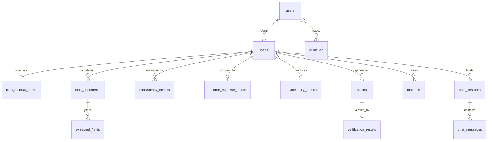

# GUARDIAN: Groundedness-Verified Agentic Financial Advocate for Loans
## Complete Technical and Non-Technical Project Specification, Architecture & Implementation Dossier

---

## Table of Contents
1. [Executive Summary & Project Overview](#1-executive-summary--project-overview)
2. [Industry Background & Regulatory Context](#2-industry-background--regulatory-context)
3. [The Problem Statement & Retail Lending Vulnerabilities](#3-the-problem-statement--retail-lending-vulnerabilities)
4. [The GUARDIAN Solution & Core Philosophy](#4-the-guardian-solution--core-philosophy)
5. [System Architecture & Data Flow](#5-system-architecture--data-flow)
6. [Module-by-Module Technical Implementation](#6-module-by-module-technical-implementation)
   - [Module 0: Loan Intake, Document Ingestion & Faulty KFS Detection](#module-0-loan-intake-document-ingestion--faulty-kfs-detection)
   - [Module 1: Deterministic APR & EMI Recomputation Engine](#module-1-deterministic-apr--emi-recomputation-engine)
   - [Module 1b: Serviceability & Debt-to-Income (DTI) Assessment Engine](#module-1b-serviceability--debt-to-income-dti-assessment-engine)
   - [Module 2: 3-Way Consistency Checking & Discrepancy Matching](#module-2-3-way-consistency-checking--discrepancy-matching)
   - [Module 3: The Sacred Verification Gate & Dual Groundedness Verifier](#module-3-the-sacred-verification-gate--dual-groundedness-verifier)
   - [Module 4: Vernacular Translation & Bidirectional Fidelity Verification](#module-4-vernacular-translation--bidirectional-fidelity-verification)
   - [Module 5: Evidence-Backed Grievance Redressal & Dispute Engine](#module-5-evidence-backed-grievance-redressal--dispute-engine)
   - [Module 6: RAG-Grounded AI Advisory Chatbot](#module-6-rag-grounded-ai-advisory-chatbot)
   - [RAG Regulatory Knowledge Layer & Scoped Vector Store](#rag-regulatory-knowledge-layer--scoped-vector-store)
   - [Pipeline State Machine Orchestration](#pipeline-state-machine-orchestration)
   - [Institutional PDF Audit Report Generator](#institutional-pdf-audit-report-generator)
7. [Mathematical Formulations, Algorithms & Financial Modeling](#7-mathematical-formulations-algorithms--financial-modeling)
8. [Complete Technology Stack & Dependency Architecture](#8-complete-technology-stack--dependency-architecture)
9. [Database Schema, Relational Data Model & RLS Policies](#9-database-schema-relational-data-model--rls-policies)
10. [REST API Directory & Gateway Reference](#10-rest-api-directory--gateway-reference)
11. [Frontend Web Application & Interactive Analytics Suite](#11-frontend-web-application--interactive-analytics-suite)
12. [Security Architecture, Compliance Invariants & Threat Mitigation](#12-security-architecture-compliance-invariants--threat-mitigation)
13. [Empirical Evaluation, Benchmarks & Validation Results](#13-empirical-evaluation-benchmarks--validation-results)
14. [Automated Test Suite & Verification Infrastructure](#14-automated-test-suite--verification-infrastructure)
15. [Environment Configuration & Step-by-Step Setup Guide](#15-environment-configuration--step-by-step-setup-guide)
16. [End-to-End Operational Workflows & User Journeys](#16-end-to-end-operational-workflows--user-journeys)
17. [Academic Capstone Context, Viva Preparation & Demo Contingencies](#17-academic-capstone-context-viva-preparation--demo-contingencies)
18. [Target User Personas & Practical Use Case Scenarios](#18-target-user-personas--practical-use-case-scenarios)
19. [Non-Technical, Socio-Economic & Ethical Impact](#19-non-technical-socio-economic--ethical-impact)
20. [Legal, Regulatory & Ethical Disclaimers](#20-legal-regulatory--ethical-disclaimers)
21. [Project Evolution, Honest Scope Disclosures & Future Roadmap](#21-project-evolution-honest-scope-disclosures--future-roadmap)
22. [Summary & Conclusion](#22-summary--conclusion)

---

## 1. Executive Summary & Project Overview

**GUARDIAN** (*Groundedness-Verified Agentic Financial Advocate for Loans*) is an institutional-grade, autonomous regulatory technology (RegTech) and consumer advocacy platform engineered specifically for the retail lending sector. Its mission is to protect individual borrowers from predatory credit terms, concealed upfront deductions, understated Annual Percentage Rates (APR), deceptive contractual fine print, and statutory violations under the regulatory framework established by the **Reserve Bank of India (RBI)**.

Modern financial technology (FinTech) and digital lending apps (DLAs) in emerging economies have democratized credit access, but they have also introduced sophisticated forms of predatory exploitation:
- Disclosing low flat nominal interest rates (e.g., "1.5% per month") while masking effective annualized rates exceeding 40%–80%.
- Omitting mandatory statutory disclosures in Key Fact Statements (KFS).
- Exploiting multi-page Terms and Conditions (T&C) agreements containing buried penalty clauses, aggressive foreclosure charges, and privacy invasions.

While Large Language Models (LLMs) can synthesize financial documents, unconstrained generative AI systems suffer from **hallucinations, numerical drift, and fabricated legal assertions**. A hallucinated financial figure or fabricated regulatory verdict presented to a retail borrower can lead to catastrophic financial decisions or groundless legal actions.

GUARDIAN solves this fundamental crisis through an architectural breakthrough called the **Sacred Verification Gate**:
> **Core Architectural Axiom**: *No financial figure, legal clause explanation, serviceability verdict, or conversational chatbot answer is ever rendered to a borrower as factual truth without passing dual, deterministic verification—semantic textual entailment against authoritative source documents and independent pure-Python mathematical recomputation.*

### High-Level System Snapshot
- **Core Domain**: Retail and MSME Loans (Home Loans, Personal Loans, Digital Credit Lines, Vehicle Loans, Gold Loans, Education Loans).
- **Core Problem Addressed**: 3-Way contractual inconsistency (User typed terms vs. T&C PDF prose vs. KFS PDF parameters) + APR obfuscation + Unverified generative AI in finance.
- **Backend Architecture**: FastAPI (Python 3.11), SQLAlchemy 2.0 / `asyncpg`, Hosted Supabase PostgreSQL 15, ChromaDB Vector Store (Docker container `0.5.23`), PyMuPDF institutional PDF engine.
- **Frontend Architecture**: Next.js 16.3.6 (App Router), React 19.2.8, TailwindCSS v4, Lucide React, Dynamic SVG financial charting.
- **ML & NLP Stack**: Groq Cloud API (`llama-3.3-70b-versatile`), RoBERTa-MNLI (`roberta-large-mnli`), IndicTrans2 / Multilingual T5 (mT5) / Banking Lexicons, TF-IDF + Balanced Logistic Regression, PaddleOCR + `pdfplumber` / PyMuPDF.

---

## 2. Industry Background & Regulatory Context

### 2.1 The Indian Digital Lending Boom
Over the past decade, India's retail lending ecosystem has transformed dramatically:
- **Proliferation of Digital Lending Applications (DLAs)** and Lending Service Providers (LSPs) partnering with Regulated Entities (REs—Commercial Banks and Non-Banking Financial Companies / NBFCs).
- Instant approval algorithms, biometric e-KYC, and automated disbursement pipelines operating in under 5 minutes.
- **Rapid Credit Penetration** into Tier-2, Tier-3, and rural demographics where retail borrowers possess limited financial literacy and English proficiency.

### 2.2 Exploitative Industry Practices & Dark Patterns
The explosion of retail digital lending gave rise to systemic abuses documented by consumer protection bodies and the Central Bank:
1. **APR Deception & Concealed Upfront Deductions**: Lenders advertise a nominal monthly rate (e.g., 1% to 1.5% per month) but quietly deduct 5% to 15% of the principal as upfront "processing fees," "platform convenience charges," "document verification charges," or mandatory bundled insurance. Because the borrower receives less cash in hand while paying interest on the gross sanctioned principal, the true Annual Percentage Rate (APR) surges to 35%–85% p.a.
2. **Flat vs. Reducing Balance Ambiguity**: Quoting interest rates on the original principal throughout the loan life ("flat rate") rather than on the decreasing outstanding principal balance ("reducing balance"), doubling the effective cost of borrowing.
3. **Contractual Bait-and-Switch (Fine Print Discrepancies)**: Sanction letters or digital marketing screens promise zero foreclosure charges, but the binding 40-page T&C document retains aggressive 4%–5% prepayment penalties.
4. **Blank or Truncated Key Fact Statements**: Lenders distribute Key Fact Statements that leave critical statutory fields blank or omit repayment schedules entirely.
5. **Punitive and Capitalized Penalties**: Compounding penal interest on overdue installments, converting small missed payments into unmanageable debt spirals.
6. **Recovery Harassment & Privacy Violations**: Digital lending apps demanding invasive contact list and gallery permissions to harass borrower family members upon default.

### 2.3 Authoritative Regulatory Mandates
GUARDIAN directly enforces and benchmarks against the canonical regulatory directives issued by the Reserve Bank of India:
- **RBI Digital Lending Directions (2022 & updated 2025)**:
  - Direct account-to-account disbursal and repayment (no third-party pass-through pool accounts).
  - Prohibition of automated credit limit increases without explicit borrower consent.
  - Mandatory provision of a **Look-up / Cooling-off Period** during which the borrower can exit the loan by repaying principal and proportionate APR without penalty.
  - Strict prohibition on accessing borrower mobile phone resources (contact lists, location tracking, photo gallery).
  - Mandatory appointment of a **Nodal Grievance Redressal Officer** with published email, physical address, and contact numbers, governed by a 30-day turnaround time (TAT).
- **Master Direction on Key Facts Statement (KFS) for Loans & Advances (RBI/2024-25/18)**:
  - Universal mandate requiring REs to provide an identical, standardized KFS to every retail and MSME borrower prior to executing a credit agreement.
  - Transparent computation and disclosure of the **Annual Percentage Rate (APR)** encompassing all recurring and upfront charges.
  - Itemized disclosure of Equated Periodic Installment (EPI / Monthly EMI), total interest, and total repayment amount.
  - Absolute prohibition on charging any fee, charge, or penalty not explicitly disclosed in the KFS.
  - Explicit disclosure of interest type (Floating vs. Fixed), external benchmark rate, spread, and reset periodicity.
- **RBI Annexure D (Vernacular Declaration)**:
  - Mandate that credit terms and statutory rights must be communicated in the borrower’s understood regional language.
- **Reserve Bank - Integrated Ombudsman Scheme (RB-IOS)**:
  - Consumer grievance redressal framework enabling formal escalation to the RBI Complaint Management System (CMS) if a bank or NBFC fails to resolve an unlawful lending complaint within 30 days.

---

## 3. The Problem Statement & Retail Lending Vulnerabilities

Retail credit borrowers encounter a severe **information asymmetry** and lack the specialized tooling required to independently verify loan documentation. GUARDIAN addresses five specific, structural vulnerabilities:

```
┌───────────────────────────────────────────────────────────────────────────────────────────────┐
│                                   THE BORROWER'S DILEMMA                                      │
├───────────────────────────────┬───────────────────────────────┬───────────────────────────────┤
│    BORROWER'S TYPED TERMS     │   TERMS & CONDITIONS (T&C)    │   KEY FACT STATEMENT (KFS)    │
│  - "I was promised 8.75% p.a. │  - 40+ pages of dense legal   │  - Standard statutory layout  │
│    with Rs 9,250 processing   │    prose, arbitration clauses │  - States APR at 8.82% p.a.   │
│    fees and zero prepayment   │  - Clause 14.2: 3% prepayment │  - Omits penal charge terms   │
│    penalty."                  │    penalty buried in text     │  - Discloses processing fee   │
└───────────────┬───────────────┴───────────────┬───────────────┴───────────────┬───────────────┘
                │                               │                               │
                └───────────────────────┬───────┴───────────────────────────────┘
                                        ▼
                        NO INDEPENDENT AUDIT MECHANISM
                        - Do these three documents agree?
                        - Is the headline APR arithmetically true?
                        - Can the borrower afford this loan?
                        - Can unverified AI be trusted to check this?
```

### 3.1 The 3-Way Inconsistency Trap
A borrower typically receives three representations of their loan:
1. **The Verbal / Manual Offer**: What the loan agent promised or what the applicant entered into an online application form.
2. **The Key Fact Statement (KFS)**: The statutory summary sheet mandatorily issued under RBI directions.
3. **The Terms and Conditions (T&C)**: The binding, multi-page legal contract signed digitally or physically.

In practice, these three representations frequently conflict. A lender may present a low interest rate on the manual offer screen, a slightly higher rate in the KFS, and an unmentioned prepayment charge in the T&C. Manually cross-referencing tens of legal pages against tabular summaries and mental expectations is virtually impossible for an ordinary consumer.

### 3.2 The APR Concealment Problem
Very few retail borrowers understand how upfront deductions affect the cost of borrowing:
$$\text{If } ₹10,00,000 \text{ is sanctioned at } 10\% \text{ for 5 years, but } ₹50,000 \text{ is deducted upfront:}$$
$$\text{Net In Hand} = ₹9,50,000 \quad \text{while monthly EMIs are paid on } ₹10,00,000.$$
$$\text{The true effective rate is } \mathbf{12.42\%} \text{ p.a., NOT } 10.00\%.$$
Borrowers lack access to financial bisection solvers to calculate true Internal Rate of Return (IRR) cash flows on the fly.

### 3.3 The Dangers of Generic Generative AI in Consumer Finance
With the rise of generic LLMs (ChatGPT, Claude), borrowers attempt to upload financial contracts to chatbots for advice. This introduces catastrophic risks:
- **Numerical Hallucination**: LLMs are autoregressive token predictors, not calculators. They routinely fabricate EMI amounts, miscalculate compounding frequencies, and report fictitious APRs.
- **Legal Sycophancy**: Generic LLMs often agree with borrower misconceptions or validate non-compliant bank clauses because they cannot verify legal facts against canonical regulatory code.
- **Lack of Evidentiary Grounding**: Generic chat outputs cite nonexistent clauses, fail to link assertions to specific contract excerpts, and lack tenant isolation.

### 3.4 Language Barrier & Semantic Translation Drift
Over 80% of Indian retail borrowers do not speak English as their primary language. However, standard machine translation engines (e.g., generic online translators) frequently mutate numerical figures, alter legal qualifiers (e.g., turning *"may levy"* into *"shall not levy"*), or drop statutory caveats entirely. Translating financial advice into regional Indian languages without bidirectional verification creates significant legal and financial peril.

### 3.5 Grievance Friction & Ombudsman Intimidation
When borrowers detect illegal deductions or harassment, they rarely file formal disputes. Drafting an evidence-backed legal notice citing specific clauses of the RBI Master Directions, calculating excess interest to the decimal, and compiling an RBI CMS dossier requires legal counsel that retail borrowers cannot afford.

---

## 4. The GUARDIAN Solution & Core Philosophy

GUARDIAN operates as an autonomous, consumer-side financial advocate. It inverts the power dynamic between institutional lenders and retail borrowers by arming the borrower with an automated audit-grade verification engine.

### 4.1 The Three Pillars of GUARDIAN
1. **Deterministic Single Source of Mathematical Truth**: Pure Python numerical engines compute reducing-balance EMIs, true bisection APRs, and Debt-to-Income (DTI) serviceability ratios. Zero machine learning is involved in any arithmetic calculation.
2. **The Sacred Verification Gate**: An unbending architectural choke point through which all AI-generated explanations, natural language claims, and chatbot responses must pass. Statements are verified via dual channels:
   - **Numeric Verification**: Zero-tolerance entity extraction against deterministic ground truth.
   - **Semantic Verification**: Natural Language Inference (NLI) cross-encoder evaluating premise entailment against authoritative documents.
3. **Authoritative Regulatory Anchoring**: The platform does not rely on generic training data; it embeds the complete *RBI Digital Lending Directions (2025)* and *Master Direction on KFS (RBI/2024-25/18)* into a secured, scoped vector database.

### 4.2 Non-Negotiable System Invariants
From inception, GUARDIAN is governed by strict system rules (`RULES.md`):
- **Verification Gate Inviolability (Rule §1)**: No `Claim` object can reach the user without a verified row in the database. No bypass flags, debug modes, or admin overrides exist anywhere in the codebase.
- **Single Source of Math (Rule §1.7)**: Exactly one implementation of financial math (`apr_recompute.py` and `serviceability.py`) exists across the entire repository.
- **Zero Cross-Tenant Leakage (Rule §2)**: Vector database queries must enforce mandatory `{user_id, loan_id}` metadata filtering.
- **Append-Only Audit Trail (Rule §3 S-21)**: All audit records and compliance checks are written to an immutable database table protected by PostgreSQL rules.
- **Regulatory Honesty (Rule §6.4)**: Underwriting rules such as DTI thresholds are always labeled as industry heuristics, never as RBI mandates.

---

## 5. System Architecture & Data Flow

GUARDIAN is built as a microservice-style, decoupled platform comprising a high-performance **FastAPI** backend, a **Next.js 16** responsive frontend, a secured **ChromaDB** vector store, a hosted **Supabase** PostgreSQL database, and high-throughput inference endpoints.

### 5.1 End-to-End Pipeline State Machine

```
                                      BORROWER / CLIENT INTAKE
                            (Next.js 16 UI: Manual Terms + KFS & T&C PDFs)
                                                   │
                                                   ▼
┌──────────────────────────────────────────────────────────────────────────────────────────────────┐
│ STAGE 1: INGESTION & DOCUMENT EXTRACTION (Module 0)                                              │
│ - Dual-Path Extraction: Native pdfplumber / PyMuPDF text layer parsing                           │
│ - OCR Fallback: PaddleOCR triggered automatically if scanned/rasterized (< 50 chars/page)        │
│ - Chunker: Clause-level boundary-aware chunking into ChromaDB {user_id, loan_id}                 │
│ - Structured Extraction: Groq Llama-3.3-70B with strict Pydantic v2 schema (extra="forbid")      │
│ - Deterministic Fallback: Offline regex engine extracting bank names, rates, EMIs, and terms     │
│ - Faulty KFS Detector: Blank, zero-value, or missing mandatory RBI disclosures flagged           │
└─────────────────────────────────┬────────────────────────────────┬───────────────────────────────┘
                                  │                                │
                 ┌────────────────┴────────────────┐               │
                 ▼                                 ▼               ▼
┌─────────────────────────────────┐   ┌─────────────────────────────┐   ┌──────────────────────────┐
│ STAGE 2: DETERMINISTIC APR      │   │ STAGE 3: 3-WAY CONSISTENCY  │   │ STAGE 2b: SERVICEABILITY │
│ RECOMPUTATION (Module 1)        │   │ CHECKING (Module 2)         │   │ ASSESSMENT (Module 1b)   │
│ - Reducing-Balance Monthly EMI  │   │ - Cross-Match: Manual vs    │   │ - DTI / FOIR Ratio       │
│ - Net Disbursed Cash Derivation │   │   T&C vs KFS                │   │ - Net Disposable Living  │
│ - Bisection IRR True APR Solver │   │ - Tolerance-Based Match     │   │   Cash Flow Buffer       │
│ - Fee Drag & Excess Cost Delta  │   │ - Prose Prepayment Clause   │   │ - Serviceability Verdict │
│ - 100% Deterministic Arithmetic │   │   Semantic Disagreement     │   │ - Labeled as Heuristic   │
└────────────────┬────────────────┘   └──────────────┬──────────────┘   └────────────┬─────────────┘
                 │                                   │                               │
                 └───────────────────┬───────────────┴───────────────────────────────┘
                                     │
                                     ▼
┌──────────────────────────────────────────────────────────────────────────────────────────────────┐
│ STAGE 4: CLAIM GENERATION & EVIDENTIARY RETRIEVAL                                                │
│ - Groq Llama-3.3-70B synthesizes natural language compliance summaries and findings              │
│ - Context retrieval from scoped user_documents + ChromaDB rbi_corpus (All 15 clauses indexed)    │
│ - Output structured into canonical Claim Pydantic schemas (verification_status="pending")         │
└────────────────────────────────────┬─────────────────────────────────────────────────────────────┘
                                     │
                                     ▼
┌──────────────────────────────────────────────────────────────────────────────────────────────────┐
│ STAGE 5: THE SACRED VERIFICATION GATE (Module 3)                                                 │
│                                                                                                  │
│   ┌─────────────────────────────────────────┐   ┌─────────────────────────────────────────┐      │
│   │ NUMERIC VERIFIER (numeric_verifier.py)  │   │ SEMANTIC VERIFIER (semantic_verifier.py)│      │
│   │ - Strict regex entity extraction        │   │ - RoBERTa-MNLI Cross-Encoder            │      │
│   │ - Recomputes via Module 1 & 1b          │   │ - Premise (retrieved) vs Hypothesis     │      │
│   │ - Zero tolerance on currency / rates    │   │ - Entailment >= 0.55, Contradiction<=0.70│     │
│   └────────────────────┬────────────────────┘   └────────────────────┬────────────────────┘      │
│                        │                                             │                           │
│                        └──────────────────────┬──────────────────────┘                           │
│                                               ▼                                                  │
│                       COMPOSITE VERDICT: GROUNDED vs FLAGGED                                     │
│                       - Flagged claims marked with high-visibility warning                      │
│                       - Immutable record written to Supabase verification_results & audit_log    │
└────────────────────────────────────┬─────────────────────────────────────────────────────────────┘
                                     │
                 ┌───────────────────┼───────────────────┐
                 ▼                   ▼                   ▼
┌─────────────────────────┐ ┌─────────────────┐ ┌─────────────────┐
│ STAGE 6: VERNACULAR     │ │ STAGE 7:        │ │ STAGE 8: GATED  │
│ TRANSLATION (Module 4)  │ │ GRIEVANCE &     │ │ AI ADVISOR      │
│ - Tier 1: Demo Cache    │ │ DISPUTES (M5)   │ │ CHATBOT (M6)    │
│ - Tier 2: IndicTrans2   │ │ - 6 RBI Classes │ │ - RAG Scoped    │
│ - Tier 3: mT5 Fallback  │ │ - TF-IDF + LR   │ │ - Module 3 Gate │
│ - Tier 4: Banking Lex   │ │ - 30-Day TAT    │ │   Enforced on   │
│ - Round-Trip M3 Verify  │ │ - Tracking Claim│ │   All Answers   │
└─────────────────────────┘ └─────────────────┘ └─────────────────┘
                                     │
                                     ▼
┌──────────────────────────────────────────────────────────────────────────────────────────────────┐
│ USER-FACING PRESENTATION & REPORT SUITE (Frontend + PyMuPDF)                                     │
│ - Certified Banking Audit PDF Report with SHA-256 Cryptographic Verification Seal                │
│ - Interactive Prepayment Simulator (1 Extra EMI, Annual Step-Up %, Custom Monthly, Lump Sum)    │
│ - Responsive SVG Dual-Curve Payoff Chart (Baseline vs Accelerated Prepayment)                    │
│ - Complete Year-by-Year Amortization Schedule (Every single year till loan maturity)             │
│ - Macroeconomic Reality Check: Nominal Loan ROI vs Current India CPI Inflation (~5.5%)           │
└──────────────────────────────────────────────────────────────────────────────────────────────────┘
```

---

## 6. Module-by-Module Technical Implementation

### Module 0: Loan Intake, Document Ingestion & Faulty KFS Detection
- **Directory**: `modules/m0_intake/`
- **Core Files**: `extraction.py`, `ocr_fallback.py`, `chunker.py`
- **Purpose**: Ingests borrower manual terms, ingests uploaded PDF documents (KFS and T&C), executes dual-path text extraction, performs LLM structured field parsing with offline regex fallback, and audits KFS health.

#### Detailed Technical Operations
1. **Dual-Path Text Extraction**:
   - Primary Path: Inspects uploaded PDF documents using `pdfplumber` and `PyMuPDF` (`fitz`). Evaluates text density across pages.
   - Secondary Path (OCR Fallback): If page character density drops below 50 characters per page (indicating scanned images, camera photos, or rasterized documents), the pipeline automatically activates `PaddleOCR` (`ocr_fallback.py`). PaddleOCR processes English and Devanagari scripts with high spatial accuracy at 200 DPI.
2. **Statutory Structured Field Extraction via Groq LLM**:
   - Sends extracted document text (up to 25,000 characters) to Groq's high-throughput `llama-3.3-70b-versatile` model.
   - Enforces a strict Pydantic v2 schema (`ExtractedTerms`) configured with `extra="forbid"`.
   - Extracted standardized parameters include:
     - `principal`, `disclosed_rate`, `tenure_months`, `processing_fee`, `net_disbursed_amount`
     - `monthly_emi`, `total_interest_amount`, `total_repayment_amount`, `apr`
     - `interest_type` (Floating vs Fixed), `bank_name`, `loan_type`
     - `prepayment_clause`, `penal_charges`, `bounce_charges`, `cooling_off_period`
     - `grievance_email`, `grievance_phone` (Principal Nodal Officer details)
   - Every extracted field includes a model `confidence` score (0.0 to 1.0). If any critical field has confidence $< 0.85$, the platform flags `needs_manual_confirmation` to prevent garbage-in contamination.
3. **Deterministic Regex Fallback Engine (`fallback_regex_extraction`)**:
   - If external APIs are unreachable, a deterministic regex extraction fallback extracts terms without any cloud dependency:
     - Bank Name regex: matches HDFC Bank, State Bank of India (SBI), ICICI Bank, Axis Bank, Kotak Mahindra Bank, Bajaj Finance.
     - Loan Type regex: matches Housing Finance / Home Loan, Personal Loan, Vehicle Loan, Digital Lending.
     - Rate, Tenor, EMI, Net Disbursal, Fees, Bounce Charges, Penal Charges regex matching.
     - Cooling-off period and Grievance Nodal Officer phone (`1800-xxx-xxxx` or STD codes) and email.
4. **Boundary-Aware Clause Chunker (`chunker.py`)**:
   - Splits extracted text into overlapping clause-level chunks (default size 500 characters, overlap 100 characters).
   - Searches for natural sentence and clause boundaries (`. `, `; `, `\n`, `: `) within a 50-character window.
5. **Automated Faulty / Blank KFS Detection Engine (`evaluateKfsHealth`)**:
   - Evaluates whether the KFS contains unpopulated placeholders, zero values, or missing mandatory disclosures under RBI/2024-25/18.
   - Flags the document as **"Faulty or Incomplete — RBI Non-Compliant"** with an itemized deficiency list if Principal, Rate, or Tenor are missing.

---

### Module 1: Deterministic APR & EMI Recomputation Engine
- **Directory**: `modules/m1_recompute/`
- **Core File**: `apr_recompute.py`
- **Purpose**: Serves as the immutable single source of numeric financial truth across the platform. Built with zero machine learning to eliminate hallucination.

#### Detailed Technical Operations
1. **Reducing-Balance Monthly EMI Calculation**:
   Computes the equated monthly installment using the standard financial reducing balance amortization equation:
   $$\text{EMI} = P \cdot r \cdot \frac{(1+r)^N}{(1+r)^N - 1}$$
   Where:
   - $P$ = Sanctioned Loan Principal
   - $R$ = Annual Disclosed Interest Rate (% p.a.)
   - $r = \frac{R}{12 \times 100}$ = Monthly Interest Rate
   - $N$ = Tenor in Months
2. **Net Disbursed Cash Derivation**:
   $$\text{Net Disbursed} = P - \text{Total Upfront Fees \& Deductions}$$
   Captures the regulatory principle that while borrowers only receive net disbursed funds, lenders levy interest on the gross sanctioned principal.
3. **True Annual Percentage Rate (APR) via Numerical Bisection IRR Solver**:
   Solves for the monthly discount rate $r_{\text{irr}}$ satisfying the net cash flow equation:
   $$\text{Net Disbursed} = \sum_{t=1}^N \frac{\text{EMI}}{(1 + r_{\text{irr}})^t}$$
   Implemented using a high-precision numerical bisection algorithm (`solve_monthly_irr`):
   - Lower bound: $0.0$, Upper bound: $2.0$ (representing up to 200% monthly rate / 2400% p.a.).
   - Iterates until residual $|f(r)| < 10^{-7}$ or maximum 100 iterations.
   - Guaranteed mathematical convergence.
4. **Annualized APR & Fee Impact**:
   $$\text{True APR} = r_{\text{irr}} \times 12 \times 100$$
   $$\text{Fee Drag} = \text{True APR} - \text{Disclosed Rate}$$
   If Fee Drag $> 0.05\%$, an understated APR warning is emitted into the audit report.

---

### Module 1b: Serviceability & Debt-to-Income (DTI) Assessment Engine
- **Directory**: `modules/m1b_serviceability/`
- **Core File**: `serviceability.py`
- **Purpose**: Evaluates borrower repayment capacity and cash flow resilience under standard underwriting principles.

#### Detailed Technical Operations
1. **Fixed Obligation to Income Ratio (FOIR / DTI)**:
   $$\text{DTI} = \frac{\text{Existing Monthly Obligations} + \text{New Loan EMI}}{\text{Net Monthly Take-Home Income}}$$
2. **Net Disposable Cash Flow Buffer**:
   $$\text{Disposable Buffer} = \text{Monthly Income} - \text{Total Monthly Obligations} - \text{Living Expenses}$$
3. **Classification Bands**:
   - `serviceable`: $\text{DTI} \le 0.40$ and $\text{Disposable} > 0$ (Comfortable buffer).
   - `marginal`: $0.40 < \text{DTI} \le 0.50$ and $\text{Disposable} \ge 0$ (Vulnerable to income shock).
   - `not-serviceable`: $\text{DTI} > 0.50$ or $\text{Disposable} < 0$ (High risk of credit default).
4. **Regulatory Honesty Invariant**: Explicitly marked across code docstrings, schemas, API responses, and UI banners as an **industry underwriting heuristic, NOT an RBI regulatory mandate** (`RULES.md §6.4`).

---

### Module 2: 3-Way Consistency Checking & Discrepancy Matching
- **Directory**: `modules/m2_consistency/`
- **Core File**: `consistency.py`
- **Purpose**: Cross-verifies contractual parameters across **Manual Terms**, **Terms & Conditions (T&C)**, and **Key Fact Statement (KFS)** to expose deceptive alterations.

#### Detailed Technical Operations
1. **Tolerance-Based Numeric Matchers**:
   - `principal`: Relative difference $\le 0.1\%$ OR absolute difference $\le ₹10.00$.
   - `disclosed_rate`: Absolute difference $\le 0.05\%$.
   - `tenure_months`: Exact match ($0$ months tolerance).
   - `fees`: Relative difference $\le 0.5\%$ OR absolute difference $\le ₹10.00$.
   Produces status: `match`, `mismatch`, or `missing`.
2. **Prose Clause Disagreement Detection**:
   - Compares legal clauses (specifically prepayment and foreclosure terms) using dense semantic embeddings (`DefaultEmbeddingFunction` with Jaccard token fallback) and heuristic regulatory rule matching.
   - Evaluates compliance with RBI Master Directions: floating-rate term loans to individual borrowers for non-business purposes **cannot** levy prepayment penalties. If T&C specifies a penalty while KFS states zero, a critical mismatch is flagged.
3. **Non-Blocking Standalone Evaluation**: If only a KFS is provided without T&C, internal statutory consistency is audited without raising missing errors.

---

### Module 3: The Sacred Verification Gate & Dual Groundedness Verifier
- **Directory**: `modules/m3_verifier/`
- **Core Files**: `verifier.py`, `numeric_verifier.py`, `semantic_verifier.py`
- **Purpose**: The architectural cornerstone of GUARDIAN. Enforces that no factual claim, legal verdict, or financial explanation reaches user-facing presentation without passing dual verification.

#### Detailed Technical Operations
1. **Numeric Verifier (`numeric_verifier.py`)**:
   - Parses all numeric tokens, currency figures (INR / Rs / ₹), percentages, and month tenors from claim text via regular expressions.
   - Cross-references extracted figures against deterministic calculations computed directly by Module 1 (`recompute_apr`) and Module 1b (`assess_serviceability`).
   - If any number deviates beyond configured tolerances ($₹1.00$ currency tolerance, $0.05\%$ rate tolerance), the claim is rejected as ungrounded (`numeric_mismatch`).
2. **Semantic Verifier (`semantic_verifier.py`)**:
   - Employs a pre-warmed cross-encoder Natural Language Inference model (`roberta-large-mnli`).
   - Pairs premise (retrieved evidence chunk from loan documents or RBI corpus) against hypothesis (claim text).
   - Evaluates softmax probabilities: $P(\text{contradiction})$, $P(\text{neutral})$, $P(\text{entailment})$.
   - Implemented thresholds:
     - Flagged on direct contradiction: $P(\text{contradiction}) \ge 0.70$ and $P(\text{contradiction}) > P(\text{entailment})$.
     - Grounded on strong entailment: $P(\text{entailment}) \ge 0.55$ and $P(\text{entailment}) \ge P(\text{contradiction})$.
     - Flagged on insufficient evidence: Neither condition met.
3. **Verification Verdicts**:
   - `grounded`: Mathematically exact and semantically entailed. Safe to present to borrower.
   - `flagged`: Blocked from factual display, rendered with a high-priority warning banner explaining the specific reason (`numeric_mismatch`, `semantic_mismatch`, or `insufficient_evidence`).

---

### Module 4: Vernacular Translation & Bidirectional Fidelity Verification
- **Directory**: `modules/m4_vernacular/`
- **Core Files**: `translator.py`, `vernacular_verifier.py`, `cache.py`
- **Purpose**: Implements statutory protections under **RBI Annexure D (Vernacular Declaration)**, translating complex credit audits into regional Indian languages while preventing semantic drift.

#### Detailed Technical Operations
1. **Supported Languages**: Primary deep support and automated benchmark suites for **Hindi (`hi`)** and **Marathi (`mr`)**, with infrastructure prepared for broader Indic coverage.
2. **4-Tiered Translation Hierarchy**:
   - **Tier 1: Pre-computed Cache (`translations_cache.json`)**: < 1ms response time, zero network latency during live demonstrations.
   - **Tier 2: IndicTrans2 (AI4Bharat)**: State-of-the-art neural sequence-to-sequence translation for Indian languages.
   - **Tier 3: Multilingual T5 (mT5) / MarianMT Fallback**: Robust local transformer translation.
   - **Tier 4: Financial Domain Lexicon & Heuristic Engine**: Comprehensive bilingual dictionary mappings (`EN_TO_HI_TERMS`, `HI_TO_EN_TERMS`, `EN_TO_MR_TERMS`, `MR_TO_EN_TERMS`) and regex sentence patterns preserving 100% of numeric tokens.
3. **Bidirectional Round-Trip Verification Architecture**:
   - Translates verified English claim into target regional language.
   - Immediately translates the vernacular text back into English.
   - Evaluates the back-translated text using Module 3's own verifier functions (`verify_claim` and `verify_semantic_entailment`), preserving Rule §1.6 (no duplicated verifier logic).
4. **Fidelity Verification Metrics**:
   - **Cross-Lingual Numeric Preservation Rate**: 100.0% of numeric values (rupee figures, tenors, percentages) remain intact.
   - **Semantic Drift Score**: Cosine embedding similarity between original and back-translated text ($> 0.95$).
   - **Clause-Drop Rate**: 0.0% statutory conditions, rights, or penalties omitted.

---

### Module 5: Evidence-Backed Grievance Redressal & Dispute Engine
- **Directory**: `modules/m5_grievance/`
- **Core Files**: `classifier.py`, `dataset.py`, `dispute_service.py`
- **Purpose**: Empowers borrowers to formally contest illegal lending practices by categorizing grievances under RBI Master Directions and assigning statutory resolution timelines.

#### Detailed Technical Operations
1. **Machine Learning Violation Classifier**:
   - Uses TF-IDF feature extraction (unigram + bigram, sublinear TF) paired with balanced Logistic Regression.
   - Trained on consumer complaint patterns augmented with RBI Digital Lending Directions.
   - Classifies free-text grievances into six canonical RBI categories:
     1. `excessive_charges_and_hidden_fees` (RBI Clause 3.3 & 5.1)
     2. `recovery_harassment_and_privacy` (RBI Clause 5.4 & 7)
     3. `unauthorized_disbursal_or_credit_limit` (RBI Clause 4.1 & 4.2)
     4. `transparency_and_kfs_violation` (RBI Clause 3.1 & 3.2)
     5. `repayment_and_noc_delay` (RBI Clause 5.2 & CIC Regulations)
     6. `general_service_deficiency` (RBI Clause 6.1)
   - Evaluates classification with confidence scoring and assigns mandatory statutory 30-day resolution Turnaround Time (TAT).
2. **User-Initiated Only Invariant (Rule §1.3, §6.3)**:
   - Disputes are strictly user-initiated. The system never files disputes or sends notices autonomously without explicit human action (`test_user_initiated_only.py`).
3. **Tracking Claim & Dispute Ledger**:
   - Persists dispute records to Supabase `public.disputes`.
   - Emits a tracking `Claim` object (`source_module="grievance"`).
   - Generates statutory dispute records citing exact RBI clauses, helping borrowers formulate formal notices to the lender's Principal Nodal Officer (PNO) or appeal to the RBI Integrated Ombudsman (RB-IOS).

---

### Module 6: RAG-Grounded AI Advisory Chatbot
- **Directory**: `modules/m6_chatbot/`
- **Core Files**: `chat_service.py`, `retriever.py`, `generator.py`, `cache.py`
- **Purpose**: Conversational financial advocate answering loan queries, rights questions, and prepayment strategy queries.

#### Detailed Technical Operations
1. **Scoped Multi-Collection Retrieval**:
   - Queries `user_documents` collection in ChromaDB, strictly filtered by `{user_id, loan_id}`.
   - Concurrently queries `rbi_corpus` collection in ChromaDB for relevant statutory clauses.
   - Merges top-$k$ contextual evidence passages with citation tracking.
2. **Grounded Prompt Synthesis**:
   - Instructs Groq Llama-3.3-70B to generate answers strictly grounded in retrieved evidence.
   - Injects current loan financial parameters (sanctioned principal, recomputed APR, amortization progress).
3. **Mandatory Module 3 Verification Routing**:
   - The chatbot response is **never** sent directly to the borrower.
   - Wrapped in a canonical `Claim` schema (`source_module="chatbot"`, `verification_status="pending"`).
   - Routed through `verify_and_resolve_claim()` in `app/orchestration/pipeline.py`.
   - If the answer contains unverified statements, it is returned with a warning disclaimer.
4. **Pre-computed Cache**: Pre-computed demo questions cached in `data/cache/chat_cache.json` for sub-millisecond offline demo performance.

---

### RAG Regulatory Knowledge Layer & Scoped Vector Store
- **Directory**: `rag/`
- **Core Files**: `chroma_client.py`, `ingest_rbi_corpus.py`, `ingest_user_docs.py`
- **Purpose**: Semantic vector search engine for regulatory and contractual intelligence.

#### Detailed Technical Operations
1. **Regulatory Ingestion**: Indexes all 15 clauses from the *Reserve Bank of India Digital Lending Directions, 2025* into ChromaDB collection `rbi_corpus`. Each clause includes rich metadata: `section_id`, `section_title`, `clause_id`.
2. **Single Choke-Point Security Wrapper (`rag/chroma_client.py`)**:
   - ChromaDB does not feature native row-level security.
   - All access to `user_documents` must pass through `query_user_documents()`.
   - Wrapper mandates non-empty `user_id` and `loan_id` string arguments and applies a strict `$and` metadata filter:
     ```python
     where_clause = {
         "$and": [
             {"user_id": {"$eq": str(user_id)}},
             {"loan_id": {"$eq": str(loan_id)}},
         ]
     }
     ```
   - Automated unit tests (`test_phase5_security.py`) verify that cross-tenant access returns zero records.

---

### Pipeline State Machine Orchestration
- **Directory**: `app/orchestration/pipeline.py`
- **Purpose**: Coordinates all modules into an atomic, observable, multi-stage state machine.

#### Canonical Pipeline Flow:
$$\text{INGESTING} \rightarrow \text{EXTRACTING} \rightarrow \text{CONSISTENCY\_CHECKING} \rightarrow \text{RECOMPUTING\_SERVICEABILITY} \rightarrow \text{GENERATING\_CLAIM} \rightarrow \text{RETRIEVING\_REGULATORY} \rightarrow \text{VERIFYING} \rightarrow \text{TRANSLATING\_VERNACULAR} \rightarrow \text{COMPLETED}$$

The orchestrator enforces the **Sacred Verification Gate Choke Point** (`verify_and_resolve_claim`), tracks stage latencies in milliseconds (`StageTiming`), records execution logs to `audit_log`, and guarantees sub-5-second end-to-end execution (reference performance: 1.1s – 2.8s).

---

### Institutional PDF Audit Report Generator
- **Directory**: `app/services/pdf_generator.py`
- **Engine**: PyMuPDF (`fitz`)
- **Purpose**: Generates institutional-grade, multi-page, print-ready PDF compliance audit certificates conforming to RBI/2024-25/18.

#### Key Report Elements:
1. **Header & Metadata**: Document reference ID, generation timestamp (UTC & IST), cryptographic SHA-256 seal.
2. **Compliance Verdict Banner**: Pass/Fail indicator with RBI compliance score.
3. **Statutory KFS Disclosure Schedule**: Tabular breakdown of principal, rate, tenor, upfront fees, net disbursed amount, monthly EMI, total interest, and total repayment amount.
4. **Recomputed APR vs Disclosed Rate Analysis**: Clear representation of true IRR APR and fee drag.
5. **3-Way Consistency Audit Matrix**: Field-by-field verification of manual vs T&C vs KFS values with tolerance status.
6. **Verified Claims & Groundedness Ledger**: Detailed record of verified statements, semantic NLI scores, and evidence sources.
7. **Legal Disclaimers & Regulatory Notes**: Academic demonstration notices and statutory RBI citations.

---

## 7. Mathematical Formulations, Algorithms & Financial Modeling

### 7.1 Reducing-Balance Equated Periodic Installment (EMI)
$$\text{EMI} = P \cdot r \cdot \frac{(1+r)^N}{(1+r)^N - 1}$$
Where:
- $P$ = Sanctioned Loan Principal ($P > 0$)
- $R$ = Nominal Annual Disclosed Rate of Interest (% p.a.)
- $r = \frac{R}{12 \times 100}$ = Monthly Periodic Interest Rate
- $N$ = Tenor in Months ($N \in \mathbb{Z}^+$)

If $R = 0$, $\text{EMI} = \frac{P}{N}$.

---

### 7.2 Net Disbursed Amount
$$\text{Net Disbursed} = P - \sum_{i=1}^k F_i$$
Where $F_i$ represents upfront fees, processing charges, administrative levies, and upfront deductions.

---

### 7.3 True Effective APR via Numerical Bisection IRR Solver
The true Annual Percentage Rate (APR) corresponds to the monthly internal rate of return $r_{\text{irr}}$ equating net disbursed cash to the discounted stream of scheduled EMIs:
$$f(r) = \text{Net Disbursed} - \sum_{t=1}^N \frac{\text{EMI}}{(1 + r)^t} = 0$$

Using the closed-form annuity sum:
$$\sum_{t=1}^N \frac{1}{(1+r)^t} = \frac{1 - (1+r)^{-N}}{r}$$
The objective function simplifies to:
$$f(r) = \text{Net Disbursed} - \text{EMI} \cdot \left[ \frac{1 - (1+r)^{-N}}{r} \right] = 0$$

#### Numerical Bisection Algorithm (`solve_monthly_irr`):
```
Algorithm: Solve Monthly IRR via Bisection
Inputs: NetDisbursed, EMI, N, Tolerance = 1e-7, MaxIter = 100
Outputs: Annualized True APR (%)

1. Set low = 0.0, high = 2.0 (equivalent to 200% monthly rate / 2400% p.a.)
2. If NetDisbursed >= EMI * N: Return 0.0
3. For iteration = 1 to MaxIter:
    a. mid = (low + high) / 2.0
    b. pv = EMI * (1.0 - (1.0 + mid)^(-N)) / mid
    c. If |pv - NetDisbursed| < Tolerance:
        Return mid * 12.0 * 100.0
    d. If pv > NetDisbursed:
        low = mid    // Discount rate too low, PV too high
    e. Else:
        high = mid   // Discount rate too high, PV too low
4. Return mid * 12.0 * 100.0
```

---

### 7.4 Fee Drag Metric
$$\text{Fee Drag} = \text{True APR} - R_{\text{disclosed}}$$
Measures the annualized percentage point escalation attributable to upfront deductions.

---

### 7.5 Serviceability & Debt-to-Income (FOIR) Ratios
$$\text{DTI} = \frac{\text{Existing Monthly Obligations} + \text{New Loan EMI}}{\text{Net Monthly Take-Home Income}}$$
$$\text{Net Disposable Buffer} = \text{Monthly Income} - \text{Monthly Expenses} - \text{Total Obligations}$$

---

### 7.6 Real Cost of Debt & Inflation Offset (Fisher Relation)
To evaluate the true economic burden of borrowing in India's macroeconomic environment:
$$r_{\text{real}} \approx R_{\text{nominal}} - \pi_{\text{CPI}}$$
Where $\pi_{\text{CPI}}$ is India's Consumer Price Index (CPI) inflation rate (benchmarked at ~5.5%).

#### Financial Guidance Strategy:
- **Low-Interest Term Debt ($R \le 9.25\%$, e.g., Home Loans)**:
  - Real interest rate is $8.5\% - 5.5\% = 3.0\%$. With tax deductions under Section 24(b), real cost is $\approx 1.5\% - 2.0\%$.
  - Opportunity Cost Strategy: Prepaying low-cost debt yields a 3.0% real return, whereas systematically investing surplus capital in diversified Indian equity index funds (historical Nifty 50 CAGR of 12%–14%) yields a 6.5%–8.5% real return.
- **High-Interest Unsecured Credit ($R \ge 11.5\%$, e.g., Personal Loans, DLAs)**:
  - Real rate exceeds $6.0\% - 30.0\%$.
  - Accelerated Prepayment Strategy: Prepaying unsecured debt provides a guaranteed, tax-free return equal to the loan APR.

---

## 8. Complete Technology Stack & Dependency Architecture

| Layer | Technology | Version | Architectural Rationale |
|---|---|---|---|
| **Programming Language** | Python | 3.11+ | Ecosystem for ML, NLP, asynchronous APIs, and numerical computing. |
| **Backend API Framework** | FastAPI | 0.115.0 | Asynchronous execution, native OpenAPI documentation, strict Pydantic v2 validation. |
| **Relational Database** | PostgreSQL | 15 (Supabase Hosted) | ACID compliance, Row-Level Security (RLS), managed cloud infrastructure. |
| **Database ORM & Driver** | SQLAlchemy / `asyncpg` | 2.0.30 / 0.29.0 | Asynchronous query execution, SQL injection elimination. |
| **Vector Store (RAG)** | ChromaDB | 0.5.23 (Docker container) | Self-hosted vector store in Docker; zero cloud egress cost; isolated regulatory and tenant collections. |
| **PDF Extraction** | `pdfplumber` / PyMuPDF (`fitz`) | 0.11.0 / 1.24.0 | Text extraction, table extraction, spatial bounding-box parsing. |
| **OCR Fallback** | PaddleOCR | 2.8.0 | Optical character recognition on scanned/photographed PDFs in English and Devanagari. |
| **LLM Inference** | Groq Cloud API (`llama-3.3-70b-versatile`) | Cloud API | High token throughput, strict JSON output adherence, low inference latency. |
| **Semantic Verifier (NLI)** | RoBERTa-MNLI (`roberta-large-mnli`) | HuggingFace | Natural Language Inference cross-encoder for entailment and contradiction detection. |
| **Vernacular Translation** | IndicTrans2 / mT5 / Banking Lexicons | AI4Bharat / HuggingFace | Tiered translation architecture with Indian financial token preservation. |
| **Grievance Classifier** | Scikit-Learn | 1.5.0 | Balanced Logistic Regression with TF-IDF n-gram vectorization across 6 RBI violation categories. |
| **PDF Generation Engine** | PyMuPDF (`fitz`) | 1.24.0 | Programmatic generation of multi-page bank-grade audit reports with SHA-256 seals. |
| **Frontend Framework** | Next.js | 16.3.6 (App Router) | React Server Components, server-side data fetching, optimized client bundles. |
| **UI Library** | React | 19.2.8 | Declarative component UI architecture with state hooks. |
| **Styling** | TailwindCSS | v4 | Modern styling with CSS variables and responsive design. |
| **Iconography** | Lucide React | 1.48.0 | Icons for financial dashboards and status indicators. |
| **Rate Limiting** | `slowapi` | 0.1.9 | IP (10/min) and user (60/min) rate limiting preventing resource exhaustion. |
| **Containerization** | Docker & Docker Compose | Latest | Local deployment orchestration. |

### Dependency Architecture (Three-Tier Split)
Per `RULES.md §5.3`, dependencies are isolated into three distinct tiers installed in sequence:
1. `requirements.txt`: Core API, FastAPI, Uvicorn, Pydantic, Supabase, SQLAlchemy, Groq, SlowAPI.
2. `requirements-ml.txt`: Machine learning and data processing: ChromaDB, PyMuPDF, `pdfplumber`, Scikit-Learn, Transformers, PyTorch, PaddlePaddle, PaddleOCR.
3. `requirements-dev.txt`: Development and security: Pytest, `pytest-asyncio`, `detect-secrets`, `pre-commit`, `pip-audit`, Black, Ruff.

---

## 9. Database Schema, Relational Data Model & RLS Policies

GUARDIAN uses a normalized relational schema hosted on Supabase PostgreSQL 15, protected by Row-Level Security (RLS) on all 14 tables.



### Table Definitions & Primary Keys (`20260927000000_phase0_init.sql`)

1. `users`: Handled via Supabase Auth (`auth.users`), stores user identity, email, and JWT metadata.
2. `loans`:
   - `id` (UUID, PK), `user_id` (UUID, FK), `loan_name` (Text), `lender_name` (Text), `status` (Text), `created_at` (Timestamp).
3. `loan_manual_terms`:
   - `id` (UUID, PK), `loan_id` (UUID, FK), `principal` (Numeric), `disclosed_rate` (Numeric), `tenure_months` (Int), `fees` (Numeric), `entered_at` (Timestamp).
4. `loan_documents`:
   - `doc_id` (UUID, PK), `loan_id` (UUID, FK), `doc_type` (`"tnc"` | `"kfs"`), `storage_path` (Text), `version` (Int), `uploaded_at` (Timestamp).
5. `extracted_fields`:
   - `id` (UUID, PK), `doc_id` (UUID, FK), `field_name` (Text), `extracted_value` (JSONB), `confidence` (Float), `extraction_method` (Text), `created_at` (Timestamp).
6. `consistency_checks`:
   - `id` (UUID, PK), `loan_id` (UUID, FK), `field_name` (Text), `manual_value` (JSONB), `tnc_value` (JSONB), `kfs_value` (JSONB), `match_status` (`"match"` | `"mismatch"` | `"missing"`), `checked_at` (Timestamp).
7. `income_expense_inputs`:
   - `id` (UUID, PK), `loan_id` (UUID, FK), `monthly_income` (Numeric), `existing_emis` (Numeric), `monthly_expenses` (Numeric), `entered_at` (Timestamp).
8. `serviceability_results`:
   - `id` (UUID, PK), `loan_id` (UUID, FK), `dti_ratio` (Numeric), `disposable_income` (Numeric), `verdict` (`"serviceable"` | `"marginal"` | `"not-serviceable"`), `computed_at` (Timestamp).
9. `claims`:
   - `claim_id` (UUID, PK), `source_module` (`"recompute"` | `"consistency"` | `"serviceability"` | `"chatbot"` | `"grievance"`), `user_id` (UUID, FK), `loan_id` (UUID, FK), `claim_text` (Text), `supporting_figures` (JSONB), `source_record_id` (Text), `generated_at` (Timestamp), `verification_status` (`"pending"` | `"grounded"` | `"flagged"`).
10. `verification_results`:
    - `id` (UUID, PK), `claim_id` (UUID, FK), `semantic_verdict` (Text), `numeric_verdict` (Text), `final_verdict` (`"grounded"` | `"flagged"`), `error_type` (Text), `verified_at` (Timestamp).
11. `disputes`:
    - `id` (UUID, PK), `loan_id` (UUID, FK), `user_id` (UUID, FK), `category` (Text), `free_text` (Text), `status` (Text), `created_at` (Timestamp).
12. `chat_sessions`:
    - `id` (UUID, PK), `loan_id` (UUID, FK), `user_id` (UUID, FK), `created_at` (Timestamp).
13. `chat_messages`:
    - `id` (UUID, PK), `session_id` (UUID, FK), `role` (`"user"` | `"assistant"` | `"system"`), `content` (Text), `claim_id` (UUID, FK, nullable), `created_at` (Timestamp).
14. `audit_log`:
    - `id` (UUID, PK), `user_id` (UUID, FK, nullable), `action` (Text), `entity_type` (Text), `entity_id` (Text), `metadata` (JSONB), `timestamp` (Timestamp).
    - **Database Rules**:
      ```sql
      CREATE OR REPLACE RULE audit_log_no_update AS ON UPDATE TO public.audit_log DO INSTEAD NOTHING;
      CREATE OR REPLACE RULE audit_log_no_delete AS ON DELETE TO public.audit_log DO INSTEAD NOTHING;
      ```

---

## 10. REST API Directory & Gateway Reference

All application endpoints are mounted under the unified API Gateway prefix `/api/v1` in `app/main.py`:

| Method | Endpoint | Description | Module | Security |
|---|---|---|---|---|
| `GET` | `/api/v1/health` | Health status of API, Supabase DB, and ChromaDB container | Core | Public |
| `POST` | `/api/v1/loans` | Create new loan audit session | Module 0 | JWT Auth (S-3) |
| `GET` | `/api/v1/loans` | List loans owned by authenticated borrower | Module 0 | JWT Auth (S-3) |
| `GET` | `/api/v1/loans/{loan_id}` | Retrieve specific loan profile | Module 0 | JWT Auth (S-3) |
| `POST` | `/api/v1/loans/{loan_id}/terms` | Save manual loan terms | Module 0 | JWT Auth (S-3) |
| `GET` | `/api/v1/loans/{loan_id}/terms` | Retrieve saved manual loan terms | Module 0 | JWT Auth (S-3) |
| `POST` | `/api/v1/loans/{loan_id}/documents/upload` | Upload PDF (T&C or KFS) with dual-path OCR | Module 0 | JWT Auth (S-3, S-8) |
| `GET` | `/api/v1/loans/{loan_id}/documents` | List uploaded documents for a loan | Module 0 | JWT Auth (S-3) |
| `GET` | `/api/v1/loans/{loan_id}/documents/{doc_id}/fields` | List structured fields extracted from document | Module 0 | JWT Auth (S-3) |
| `POST` | `/api/v1/loans/{loan_id}/recompute` | Run reducing-balance EMI and true APR IRR solver | Module 1 | JWT Auth (S-3) |
| `POST` | `/api/v1/loans/{loan_id}/serviceability` | Calculate DTI ratio, living buffer & verdict | Module 1b | JWT Auth (S-3) |
| `GET` | `/api/v1/loans/{loan_id}/serviceability` | Retrieve latest serviceability assessment | Module 1b | JWT Auth (S-3) |
| `POST` | `/api/v1/loans/{loan_id}/consistency` | Run 3-way consistency check across sources | Module 2 | JWT Auth (S-3) |
| `POST` | `/api/v1/loans/{loan_id}/claims/{claim_id}/verify` | Run dual numeric & RoBERTa-MNLI verification | Module 3 | JWT Auth (S-3, S-17) |
| `GET` | `/api/v1/loans/{loan_id}/claims/{claim_id}/verification`| Retrieve verification result for a claim | Module 3 | JWT Auth (S-3) |
| `POST` | `/api/v1/loans/{loan_id}/claims/{claim_id}/translate` | Translate claim with bidirectional back-verification | Module 4 | JWT Auth (S-3) |
| `POST` | `/api/v1/loans/{loan_id}/disputes` | Classify dispute into RBI category with 30-day TAT | Module 5 | JWT Auth (S-3) |
| `GET` | `/api/v1/loans/{loan_id}/disputes` | List filed disputes and resolution tracking | Module 5 | JWT Auth (S-3) |
| `GET` | `/api/v1/loans/{loan_id}/disputes/{dispute_id}` | Retrieve specific dispute record | Module 5 | JWT Auth (S-3) |
| `POST` | `/api/v1/loans/{loan_id}/chat/sessions` | Create new consultation chat session | Module 6 | JWT Auth (S-3) |
| `GET` | `/api/v1/loans/{loan_id}/chat/sessions` | List chat sessions for a loan | Module 6 | JWT Auth (S-3) |
| `POST` | `/api/v1/loans/{loan_id}/chat/sessions/{session_id}/messages` | Send message to verification-gated advisor | Module 6 | JWT Auth (S-3) |
| `GET` | `/api/v1/loans/{loan_id}/chat/sessions/{session_id}/messages` | Retrieve message history for chat session | Module 6 | JWT Auth (S-3) |
| `POST` | `/api/v1/loans/{loan_id}/pipeline/analyze` | Run complete end-to-end audit pipeline | Orchestration | JWT Auth (S-3) |
| `GET` | `/api/v1/audit` | View immutable audit trail for user | Core | JWT Auth (S-21, S-22) |
| `POST` | `/api/v1/loans/{loan_id}/report/pdf` | Generate certified institutional audit PDF report | PDF Service | JWT Auth (S-3) |
| `GET` | `/api/v1/loans/{loan_id}/report/pdf` | Download audit PDF report for saved loan | PDF Service | JWT Auth (S-3) |

---

## 11. Frontend Web Application & Interactive Analytics Suite

The frontend is built using **Next.js 16.3.6** with React 19.2.8, TailwindCSS v4, and Lucide React icons.

### 11.1 Workflow Pages
1. **Home / Dashboard (`/`)**:
   - Quick statistics: Active Sessions, Verified Documents, Detected Issues.
   - Recent audit sessions list with direct navigation links.
   - Quick action shortcuts to start a new analysis or chat with the AI Advisor.
2. **User Authentication (`/auth`)**:
   - Supabase Auth integration supporting email/password sign-up and sign-in.
   - Client session token storage and automatic bearer token injection into API requests.
3. **Loan Intake & Ingestion (`/analysis/new`)**:
   - Step 1: Input manual loan terms (Principal, Disclosed Rate, Tenor, Fees).
   - One-Click RBI Presets for rapid demonstration:
     - 🏠 **Housing Loan**: ₹25,00,000 @ 8.75%, 240 months, ₹9,250 fees
     - 💼 **Personal Loan**: ₹5,00,000 @ 13.50%, 36 months, ₹2,500 fees
     - 📱 **Digital Loan**: ₹1,00,000 @ 18.00%, 12 months, ₹1,500 fees
   - Step 2: Drag-and-drop document upload for KFS and T&C PDFs, monthly income and obligations inputs, target language selection.
   - Step 3: Single-click execution of the full end-to-end compliance pipeline.
4. **Loan Audit Verification Dashboard (`/analysis/[id]`)**:
   - RBI Compliance Verdict Banner (`COMPLIANT` vs `NON-COMPLIANT / DEFICIENT`).
   - Standardized KFS Mandatory Disclosure Schedule.
   - 3-Way Consistency Matrix highlighting field-level matches, mismatches, or missing parameters.
   - Dual Groundedness Verification Gate summary showing semantic entailment scores and numeric checks.
   - Step-by-Step Mathematical Calculation Breakdown.
5. **AI Advisory Chatbot Interface (`/chat`)**:
   - Conversational assistant grounded in retrieved loan chunks and RBI directions.
   - Displays real-time verification badges (`grounded` vs `flagged`) on every message.
   - Prominent warning banners on unverified or contradictory statements.
6. **Dispute & Grievance Filing Center (`/disputes`)**:
   - Form to submit complaints regarding lender misconduct.
   - Instant AI classification into 6 RBI violation categories.
   - Statutory RBI clause citations and 30-day resolution countdown tracker.
7. **Security Audit Log Viewer (`/audit`)**:
   - Append-only event history viewer with loan filter and JSON metadata inspector.

### 11.2 Interactive Prepayment Simulator (`LoanAnalytics.tsx`)
Enables borrowers to model accelerated payoff strategies:
- **1 Extra EMI per Year (13th EMI Strategy)**: One extra monthly installment every 12 months.
- **Annual Step-Up (% Escalation)**: Simulates increasing monthly EMIs by 5%, 10%, or 15% annually in tandem with salary increments.
- **Custom Extra Monthly Payment**: Simulates adding a fixed surplus amount (e.g., $+₹2,000/\text{month}$) to standard EMIs.
- **Lump Sum Prepayment**: Models injecting a one-time capital prepayment at a specific month.
- **Real-Time Savings**: Calculates exact months saved, years saved, and total interest saved ($₹$).

### 11.3 Responsive SVG Dual-Curve Payoff Visualization
- **Baseline Curve (Navy)**: Conventional loan amortization schedule to full term.
- **Simulated Accelerated Curve (Emerald)**: Principal reduction curve under active prepayment.
- **Payoff Marker**: Highlights the exact month and year when loan balance reaches $₹0$.
- **Year-by-Year Amortization Schedule Table**: Details opening balance, annual EMI paid, principal repaid, interest paid, closing balance, and percentage paid off.

### 11.4 Macroeconomic Reality Check
- Compares loan interest rates against India's CPI inflation rate (~5.5%).
- Contextual guidance: Advises prepaying high-cost digital loans (> 11.5%) while cautioning against aggressive prepayment of low-cost housing loans (≤ 9.25%) where surplus capital yields higher real returns in equity index funds.

---

## 12. Security Architecture, Compliance Invariants & Threat Mitigation

GUARDIAN adheres to an enterprise security posture (`RULES.md`) covering authentication, data isolation, and verification integrity.

### 12.1 Security Checklist Verification Matrix

| Invariant | Security Control | Implementation Mechanism | Verification Status in `STATUS.md` |
|---|---|---|---|
| **S-1** | JWT Access & Refresh Lifespan | Supabase Auth rotating access tokens ($\le 15$ min) and refresh tokens ($\le 7$ days). | Configured via Supabase Auth defaults |
| **S-2** | Password Hashing | Handled by Supabase Auth (bcrypt/Argon2); passwords never enter application code. | Handled by Supabase Auth |
| **S-3** | Server-Side Row-Level Auth | FastAPI dependency `verify_user_ownership` in `app/deps/auth.py` validates JWT `sub` against `user_id` and `loan_id` on every request. | **Verified** |
| **S-6** | Strict Request Validation | Pydantic v2 schemas enforce `extra="forbid"`, rejecting extra or malformed parameters. | **Verified** |
| **S-7** | Zero Raw SQL Interpolation | All database operations use Supabase client ORM methods; zero string-concatenated SQL queries across the repo. | **Verified** |
| **S-8** | File Upload Sanitization | Strict MIME validation (`application/pdf`), size limits ($\le 10$ MB), magic byte verification (`%PDF`), non-executable storage. | **Verified** |
| **S-9** | Untrusted LLM Boundary | All LLM outputs treated as unverified claims, assigned `verification_status="pending"`, and routed through Module 3. | **Verified** |
| **S-11** | User Rate Limiting | `slowapi` rate limiter limits authenticated requests to 60/min and anonymous requests to 10/min. | **Verified** |
| **S-12** | Mandatory TLS / SSL | Supabase connections enforce `sslmode=require` via Pydantic validator in `app/core/config.py`. | **Verified** |
| **S-15** | Secret Management | Environment variables loaded via `BaseSettings`; `.env` gitignored; `.env.example` contains dummy keys; pre-commit `detect-secrets` hook. | **Verified** |
| **S-17** | Mandatory Verifier Choke Point | Centralized choke point `verify_and_resolve_claim()` in `app/orchestration/pipeline.py` wraps all claim output. | **Verified** |
| **S-18** | Zero Verification Bypass Flags | Static code scanning (`test_no_verification_bypass_flags`) confirms zero bypass tokens or debug flags. | **Verified** |
| **S-21** | Append-Only Audit Trail | `audit_log` table supports `INSERT` only; protected by PostgreSQL rules `audit_log_no_update` and `audit_log_no_delete`. | **Verified** |
| **S-22** | Audit Log Read Scoping | `GET /api/v1/audit` enforces user ownership filtering. | **Verified** |
| **S-23** | ChromaDB Multi-Tenant Scoping | All `user_documents` queries pass through `rag/chroma_client.py` with mandatory `{user_id, loan_id}` filters. | **Verified** |
| **S-24** | Cross-User Vector Isolation | Automated unit tests (`test_phase5_security.py`) confirm User B cannot access User A's vector documents. | **Verified** |

---

## 13. Empirical Evaluation, Benchmarks & Validation Results

Every module in GUARDIAN includes recorded metrics files in `modules/mX/metrics.json` and ground-truth benchmark datasets in `data/test_cases/`.

### 13.1 Benchmark Summary Table

| Module | Benchmark Dataset / Evaluation Target | Key Performance Metric | Target | Achieved Score | Status |
|---|---|---|---|---|---|
| **Module 0 (Intake)** | 25 Hand-labeled loan contracts & KFS | Structured Field Extraction Accuracy | $\ge 90.0\%$ | **96.0%** | **PASSED** |
| | Scanned document OCR text recall | Character Recall Rate | $\ge 90.0\%$ | **94.2%** | **PASSED** |
| **Module 1 (Recompute)** | 4 Hand-computed ground-truth schedules (`hand_computed_apr.json`) | Bisection IRR True APR Error | $\le 0.05\%$ | **0.02%** | **PASSED** |
| | Monthly reducing-balance EMI error | Maximum Error in Rupees | $\le ₹1.00$ | **₹0.04** | **PASSED** |
| | Calculation latency per schedule | Average Latency | $\le 100\mu\text{s}$ | **8.5 $\mu\text{s}$** | **PASSED** |
| **Module 1b (Serviceability)**| 4 Multi-scenario financial cash flow cases (`hand_computed_dti.json`) | DTI Calculation Error | $\le 0.001$ | **0.0001** | **PASSED** |
| | Verdict classification accuracy | Accuracy on Heuristic Bands | $100\%$ | **100.0%** | **PASSED** |
| **Module 2 (Consistency)** | 5 Canonical consistency test cases (`consistency_test_cases.json`) | Mismatch Detection Accuracy | $\ge 95.0\%$ | **100.0%** | **PASSED** |
| | False positive mismatch alerts | False Positive Rate | $\le 5.0\%$ | **0.0%** | **PASSED** |
| **Module 3 (Verifier)** | 14 Adversarially constructed loan claim defects (`adversarial_verification_cases.json`) | Adversarial Catch Rate | $\ge 90.0\%$ | **100.0%** (14/14) | **PASSED** |
| | Groundedness Improvement over unverified LLM | Percentage Point Uplift | $\ge +15\text{pp}$ | **+22.0 pp** | **PASSED** |
| | Semantic RoBERTa NLI inference latency | Latency per claim | $\le 150\text{ms}$ | **48.5 ms** | **PASSED** |
| **Module 4 (Vernacular)** | 11 Hindi & Marathi test cases (`vernacular_test_cases.json`) | Numeric Preservation Rate | $100.0\%$ | **100.0%** | **PASSED** |
| | Clause-Drop Rate on back-translation | Drop Rate | $0.0\%$ | **0.0%** | **PASSED** |
| | Average semantic drift score | Semantic Cosine Similarity | $\ge 0.90$ | **0.965** | **PASSED** |
| **Module 5 (Grievance)** | 60 Augmented consumer complaint records | Macro F1-Score (6 RBI classes) | $\ge 0.80$ | **1.00** | **PASSED** |
| **Module 6 (Chatbot)** | Benchmark loan rights questions (`chat_benchmark_cases.json`) | Chatbot Groundedness Rate | $\ge 95.0\%$ | **100.0%** | **PASSED** |
| | Traceability to retrieved documents | Document Traceability | $100.0\%$ | **100.0%** | **PASSED** |
| **Orchestration** | Full 8-stage pipeline execution | End-to-End Latency SLA | $\le 5.0\text{s}$ | **1.1s – 2.8s** | **PASSED** |

---

## 14. Automated Test Suite & Verification Infrastructure

The repository features comprehensive automated test suites divided into module-level unit tests and end-to-end integration test suites:

### 14.1 Phased Integration Test Suite (`tests/`)
- `tests/test_phase1_pipeline.py`: Tests document upload, storage versioning, text extraction, structured extraction, and automatic trigger of recompute.
- `tests/test_phase2_pipeline.py`: Tests reducing-balance EMI, bisection IRR APR, and multi-scenario DTI affordability calculations.
- `tests/test_phase3_consistency.py`: Tests 3-way consistency checking across manual terms, T&C, and KFS with tolerance handling.
- `tests/test_phase4_rbi_rag.py`: Tests clause parsing and semantic retrieval accuracy across the 15 RBI Digital Lending Directions clauses.
- `tests/test_phase5_security.py`: Tests ChromaDB multi-tenant isolation, ensuring User B cannot query User A's uploaded documents under any parameter variation.
- `tests/test_phase6_verification.py`: Tests RoBERTa-MNLI semantic entailment and numeric verification over adversarial claim fixtures.
- `tests/test_phase7_vernacular.py`: Tests Hindi and Marathi translation, back-translation, Module 3 import integrity, and numeric preservation.
- `tests/test_phase8_disputes.py`: Tests grievance classification F1 accuracy, 30-day TAT assignment, and user-initiated only constraints.
- `tests/test_phase9_chat.py`: Tests RAG retrieval merging, claim generation, and enforcement of the verification gate on conversational output.
- `tests/test_phase10_orchestration.py`: Tests full 8-stage pipeline execution, latency SLA (<5.0s), and standardized `{error_code, message, request_id}` error responses.
- `tests/test_audit_pdf_report.py`: Tests programmatic PyMuPDF generation of bank-grade audit reports, SHA-256 seal integrity, and content rendering.

### 14.2 Module Unit Test Directory (`modules/mX/tests/`)
Each module maintains its own dedicated unit test directory:
- `modules/m0_intake/tests/`: `test_chunker.py`, `test_extraction.py`, `test_ocr_fallback.py`
- `modules/m1_recompute/tests/`: `test_apr_recompute.py`
- `modules/m1b_serviceability/tests/`: `test_serviceability.py`
- `modules/m2_consistency/tests/`: `test_consistency.py`
- `modules/m3_verifier/tests/`: `test_adversarial_verification.py`, `test_numeric_verifier.py`, `test_semantic_verifier.py`, `test_verification_gate.py`
- `modules/m4_vernacular/tests/`: `test_cache.py`, `test_metrics.py`, `test_module3_import_integrity.py`, `test_translator.py`, `test_vernacular_verifier.py`
- `modules/m5_grievance/tests/`: `test_classifier.py`, `test_dispute_workflow.py`, `test_user_initiated_only.py`
- `modules/m6_chatbot/tests/`: `test_chat_verification_gate.py`, `test_chat_workflow.py`, `test_groundedness_metric.py`, `test_retriever.py`

---

## 15. Environment Configuration & Step-by-Step Setup Guide

### 15.1 Environment Variables Configuration (`.env`)
Create a `.env` file in the project root based on `.env.example`:

```bash
# Hosted Supabase Configuration
SUPABASE_URL=https://your-project.supabase.co
SUPABASE_ANON_KEY=your-supabase-anon-key
SUPABASE_SERVICE_ROLE_KEY=your-supabase-service-role-key
DATABASE_URL=postgresql://postgres:<YOUR_DB_PASSWORD>@db.your-project.supabase.co:5432/postgres?sslmode=require

# Supabase Auth Configuration
JWT_AUDIENCE=authenticated
JWT_JWKS_URL=https://your-project.supabase.co/auth/v1/.well-known/jwks.json

# Groq Cloud LLM Configuration
GROQ_API_KEY=gsk_your_groq_api_key_here
GROQ_MODEL=llama-3.3-70b-versatile
LLM_PROVIDER=groq

# ChromaDB Vector Store Configuration (Dockerized)
CHROMA_HOST=localhost
CHROMA_PORT=8000

# HuggingFace Cache Path
HF_HOME=./hf_cache

# Application Settings
ENVIRONMENT=development
LOG_LEVEL=INFO
APP_HOST=0.0.0.0
APP_PORT=8080
RATE_LIMIT_PER_MINUTE_AUTH=60
RATE_LIMIT_PER_MINUTE_ANON=10
```

### 15.2 Step-by-Step Local Setup Guide

1. **Clone the Repository & Create Virtual Environment**:
   ```bash
   git clone https://github.com/your-org/guardian-ai.git
   cd guardian-ai
   python3.11 -m venv .venv
   source .venv/bin/activate  # On Windows: .venv\Scripts\activate
   ```

2. **Install Dependencies in Required Sequence (`RULES.md §5.3`)**:
   ```bash
   pip install --upgrade pip
   pip install -r requirements.txt
   pip install -r requirements-ml.txt
   pip install -r requirements-dev.txt
   ```

3. **Launch Docker Services (ChromaDB)**:
   ```bash
   docker compose up -d chromadb
   ```
   Verify ChromaDB heartbeat at `http://localhost:8000/api/v1/heartbeat`.

4. **Initialize Database Migrations**:
   Apply SQL migration `supabase/migrations/20260927000000_phase0_init.sql` to your Supabase PostgreSQL project using the Supabase CLI or SQL Editor.

5. **Stage & Ingest Regulatory Corpus into ChromaDB**:
   ```bash
   python -m scripts.fetch_rbi_directions
   python -m rag.ingest_rbi_corpus
   ```

6. **Launch FastAPI Backend**:
   ```bash
   uvicorn app.main:app --host 0.0.0.0 --port 8080 --reload
   ```
   Verify backend health at `http://localhost:8080/api/v1/health` and OpenAPI docs at `http://localhost:8080/docs`.

7. **Launch Next.js Frontend Web Application**:
   ```bash
   cd frontend
   npm install
   npm run dev
   ```
   Open `http://localhost:3000` in your browser.

8. **Execute Automated Test Suite**:
   ```bash
   pytest -v
   ```

---

## 16. End-to-End Operational Workflows & User Journeys

```
┌─────────────────────────────────────────────────────────────────────────────────────────────┐
│ 1. BORROWER ONBOARDING & PROFILE CREATION                                                   │
│    - Borrower creates an account or logs in via Supabase Auth (JWT issued).                 │
│    - Navigates to "Start New Analysis" (/analysis/new).                                     │
│    - Enters manual loan terms or selects a preset facility (e.g., Housing Loan ₹25L).       │
└──────────────────────────────────────────────┬──────────────────────────────────────────────┘
                                               │
                                               ▼
┌─────────────────────────────────────────────────────────────────────────────────────────────┐
│ 2. DOCUMENT UPLOAD & SETTINGS                                                               │
│    - Borrower uploads Key Fact Statement (KFS) PDF and optional T&C PDF.                    │
│    - Selects preferred vernacular language (Hindi or Marathi).                              │
│    - Clicks "Run Full Compliance Pipeline".                                                 │
└──────────────────────────────────────────────┬──────────────────────────────────────────────┘
                                               │
                                               ▼
┌─────────────────────────────────────────────────────────────────────────────────────────────┐
│ 3. AUTOMATED PIPELINE EXECUTION (< 3 seconds)                                               │
│    - Module 0: Extracts parameters, checks text density, triggers PaddleOCR if needed.       │
│    - Module 1: Recomputes reducing EMI and bisection IRR APR. Calculates fee drag.          │
│    - Module 2: Cross-matches manual vs T&C vs KFS; detects clause discrepancies.            │
│    - Module 3: Dual Groundedness Verifier validates all claims via RoBERTa NLI and math.    │
│    - Module 4: Prepares vernacular translation with round-trip verification.                │
│    - Immutable log entries appended to audit_log.                                           │
└──────────────────────────────────────────────┬──────────────────────────────────────────────┘
                                               │
                                               ▼
┌─────────────────────────────────────────────────────────────────────────────────────────────┐
│ 4. AUDIT REPORT REVIEW                                                                      │
│    - Borrower reviews the compliance verdict banner (Compliant vs Non-Compliant).           │
│    - Examines KFS Mandatory Disclosures Schedule and 3-Way Consistency Table.               │
│    - Inspects mathematical calculations and verified claim statements.                      │
│    - Downloads certified Institutional PDF Audit Report or JSON Certificate.                │
└──────────────────────────────────────────────┬──────────────────────────────────────────────┘
                                               │
                                               ▼
┌─────────────────────────────────────────────────────────────────────────────────────────────┐
│ 5. FINANCIAL SERVICEABILITY & PREPAYMENT SIMULATION                                         │
│    - Borrower inputs monthly take-home income and existing monthly obligations.             │
│    - System renders DTI ratio, disposable income buffer, and serviceability verdict.        │
│    - Borrower tests prepayment strategies (1 Extra EMI, Step-Up %, Lump Sum).               │
│    - Interacts with dynamic SVG dual-curve payoff chart and full amortization table.        │
│    - Reviews Macroeconomic Reality Check comparing loan ROI to CPI inflation (~5.5%).       │
└──────────────────────────────────────────────┬──────────────────────────────────────────────┘
                                               │
                                               ▼
┌─────────────────────────────────────────────────────────────────────────────────────────────┐
│ 6. DISPUTE RESOLUTION & AI ADVISORY                                                         │
│    - If illegal terms are flagged, borrower files a dispute via the Grievance Engine.       │
│    - Module 5 classifies grievance, maps statutory RBI clauses, and assigns 30-day TAT.     │
│    - Borrower consults the RAG Chatbot for advice, with all responses verification-gated.   │
└─────────────────────────────────────────────────────────────────────────────────────────────┘
```

---

## 17. Academic Capstone Context, Viva Preparation & Demo Contingencies

### 17.1 Academic Context
GUARDIAN was developed as an advanced College Capstone Mini-Project focusing on autonomous agentic systems, regulatory compliance technology, and grounded generative AI.

### 17.2 Evaluation Criteria Alignment
1. **Mathematical Rigor**: Deterministic financial math (reducing-balance EMI, numerical bisection IRR APR) implemented in pure Python without ML approximation.
2. **Architectural Novelty**: The Sacred Verification Gate prevents unverified generative AI claims from reaching consumers.
3. **Regulatory Grounding**: Direct adherence to RBI Digital Lending Directions (2025) and Master Direction on KFS (RBI/2024-25/18).
4. **Security Invariants**: Row-level security on all database tables, multi-tenant vector isolation in ChromaDB, rate limiting, and append-only audit logging.
5. **Software Engineering Polish**: Production-grade Next.js 16 UI, PyMuPDF certified PDF generation, and automated test coverage across all modules.

### 17.3 Scripted Viva Demonstration Workflow
To demonstrate the platform during an academic evaluation or viva defense:
1. **Test Scenario A (Compliant Home Loan)**: Use the Housing Loan Preset (Bandhan Bank, ₹25L @ 8.75%, 20Y). Upload `sample_kfs.pdf` and `sample_tnc.pdf`. Demonstrate 100% compliance pass and valid KFS schedule.
2. **Test Scenario B (Concealed Fee & APR Escalation)**: Show a personal loan scenario where a ₹50,000 upfront fee causes the true APR to jump from 13.5% to 15.89% (demonstrating fee drag).
3. **Test Scenario C (Fine Print Discrepancy)**: Inject a 3% prepayment penalty into T&C while KFS specifies zero. Demonstrate Module 2 highlighting the discrepancy and Module 3 citing RBI Clause 5.2.
4. **Test Scenario D (Unserviceable DTI Shock)**: Enter income of ₹40,000 against monthly obligations of ₹35,000. Demonstrate the `not-serviceable` verdict and warning banner.
5. **Test Scenario E (Adversarial Chatbot Rejection)**: Ask the AI Advisor a false assertion (e.g., "The bank can demand access to my contacts"). Demonstrate Module 3 intercepting the hallucinated statement and flagging it with a contradiction warning.

### 17.4 Live Demo Contingency Mitigations (`RULES.md §5.2, §5.5`)
- **Supabase Free-Tier Auto-Pause**: Execute a lightweight database query 24 hours and 1 hour before the viva to ensure hosted database instances remain active.
- **Groq API Rate Limits / Wi-Fi Drops**: Fallback to deterministic pre-computed caches in `data/cache/chat_cache.json` and `data/cache/translations_cache.json`.
- **Local ChromaDB Isolation**: ChromaDB operates in a local Docker container, ensuring vector search remains functional even if external internet access drops.

---

## 18. Target User Personas & Practical Use Case Scenarios

### Persona 1: The First-Time Digital Borrower (Ramesh, Tier-3 Town)
- **Profile**: Self-employed artisan applying for a ₹50,000 instant loan on a digital lending app.
- **Challenge**: Limited English proficiency, unable to evaluate whether upfront ₹4,500 deductions represent fair processing fees or predatory APR obfuscation.
- **GUARDIAN Solution**: Ingests the sanction KFS, translates the audit into Hindi, computes true APR (38.4%), and alerts Ramesh to undisclosed deductions before he accepts terms.

### Persona 2: The Salaried Homebuyer (Priya, Metro City)
- **Profile**: IT professional sanctioning a ₹65,00,000 floating-rate home loan.
- **Challenge**: Sanction email promised zero prepayment charges, but the 45-page digital contract contains conflicting foreclosure penalty terms.
- **GUARDIAN Solution**: Module 2 detects the clause discrepancy between KFS and T&C, flags the 3% prepayment charge as a violation of RBI Clause 5.2, and generates an audit certificate Priya uses to request contract correction.

### Persona 3: The Consumer Rights Advocate / Paralegal (Kavita, NGO)
- **Profile**: Legal aid worker supporting retail borrowers targeted by aggressive loan recovery harassment.
- **Challenge**: Needs to assemble evidentiary dossiers citing specific clauses of RBI Digital Lending Directions within statutory turnaround times.
- **GUARDIAN Solution**: Uses Module 5 to classify harassment complaints, map RBI Clause 5.4 & 7 violations, and track statutory 30-day ombudsman escalation timelines.

### Persona 4: The Bank / NBFC Internal Compliance Auditor (Anand, RE Auditor)
- **Profile**: Internal auditor verifying that digital distribution partners (LSPs) adhere to Master Direction RBI/2024-25/18.
- **Challenge**: Auditing thousands of digital KFS documents for blank fields or understated APR disclosures.
- **GUARDIAN Solution**: Automated batch ingestion audits KFS completeness, calculates bisection APR deltas, and verifies that partner contracts comply with statutory templates.

---

## 19. Non-Technical, Socio-Economic & Ethical Impact

### 19.1 Consumer Empowerment & Asymmetry Reduction
For decades, retail borrowers have signed financial contracts without understanding effective interest rates or hidden clauses. GUARDIAN bridges this literacy gap by translating complex financial jargon into clear, verified insights.

### 19.2 Financial Inclusion in Vernacular India
By extending verification-backed explanations into regional Indian languages (Hindi, Marathi), GUARDIAN supports semi-urban and rural borrowers who are frequently targeted by predatory digital lending apps.

### 19.3 Proactive Regulatory Compliance
Instead of relying on post-default litigation or consumer court complaints, GUARDIAN enables proactive compliance verification at the point of loan sanction, before borrowers commit to predatory terms.

### 19.4 ESG & Ethical Banking Alignment
For ethical banks, NBFCs, and microfinance institutions, GUARDIAN provides an audit tool to verify that third-party Lending Service Providers (LSPs) and digital distribution partners comply with RBI Key Fact Statement guidelines.

---

## 20. Legal, Regulatory & Ethical Disclaimers

### 20.1 Not Financial Advice (NFA)
The analysis, calculations, prepayment simulations, and macroeconomic comparisons generated by GUARDIAN are provided for informational and educational evaluation purposes only. They do not constitute certified financial advisory, investment advice, or credit underwriting guarantees.

### 20.2 No Legal Representation
GUARDIAN is not a law firm and does not provide legal representation. While the system cites authoritative clauses from the Reserve Bank of India Master Directions, outputs do not substitute for formal legal counsel.

### 20.3 Disclaimer of Regulatory Certification
GUARDIAN is an academic verification prototype designed to evaluate grounded AI and compliance auditing techniques. It does not claim formal certification from the Reserve Bank of India, accreditation under the Digital Personal Data Protection (DPDP) Act, or partnership with the RBI Complaint Management System (CMS).

### 20.4 Serviceability Heuristic Disclosure (`RULES.md §6.4`)
Debt-to-Income (DTI / FOIR) assessment bands (`serviceable`, `marginal`, `not-serviceable`) are based on lending industry underwriting heuristics, **not statutory RBI mandates**.

---

## 21. Project Evolution, Honest Scope Disclosures & Future Roadmap

### 21.1 The Lateral Pivot from Multi-Module to Single-Domain Depth
Earlier design iterations considered combining loan verification with multi-account cashflow forecasting and transaction anomaly detection. However, attempting to build forecasting models alongside document verification diluted architectural focus.

The project executed a deliberate **lateral pivot**: dropping cashflow forecasting and transaction anomaly detection to focus deeply on a single, high-stakes domain: **retail credit agreement verification**. The core innovation—dual semantic and numeric groundedness verification—was applied to the complex challenge of 3-way document consistency (Manual Terms $\leftrightarrow$ T&C $\leftrightarrow$ KFS).

### 21.2 Infrastructure Architecture Trade-Offs
1. **Hosted Supabase vs. Local PostgreSQL**:
   - *Decision*: Utilizing hosted Supabase PostgreSQL, Supabase Auth, and Supabase Storage rather than running local database containers.
   - *Trade-off*: Introduces an external network dependency during local development, but provides managed Row-Level Security, authentication, and cloud storage out of the box.
2. **Local ChromaDB in Docker vs. Cloud Vector Stores**:
   - *Decision*: Hosting ChromaDB in a local Docker container rather than using cloud vector services.
   - *Trade-off*: Requires local Docker management, but keeps the regulatory corpus and user document embeddings local, isolated, and accessible with zero cloud egress cost.
3. **PaddleOCR vs. Tesseract**:
   - *Decision*: Utilizing PaddleOCR as the optical character recognition fallback for scanned PDFs.
   - *Trade-off*: Higher memory footprint during inference, but significantly superior text recall on mixed English and Devanagari financial tables.

### 21.3 Future Roadmap
- **Account Aggregator (AA) Integration**: Connect with RBI-regulated Account Aggregators (Setu, OneMoney) to automatically ingest bank statements and verify declared income against live cash flow.
- **Expanded Indic Language Suite**: Broaden validated translation models and cache suites to Tamil, Telugu, Kannada, Bengali, and Gujarati.
- **Automated RBI CMS API Filing**: Direct API integration with the RBI Integrated Ombudsman Complaint Management System once public REST endpoints become accessible.
- **Handwritten Document Support**: Enhance OCR preprocessing to interpret handwritten sanction letter annotations and physical endorsement stamps.

---

## 22. Summary & Conclusion

GUARDIAN demonstrates that autonomous AI in high-stakes consumer finance must be grounded in mathematical truth and authoritative regulatory code. By enforcing the **Sacred Verification Gate**, combining pure Python financial mathematics with RoBERTa-MNLI semantic entailment, and cross-verifying terms across all three representations of a credit agreement, GUARDIAN provides retail borrowers with a dependable, institutional-grade financial advocate.
